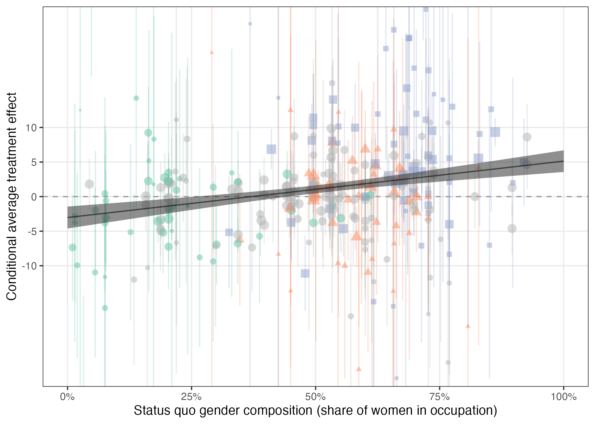
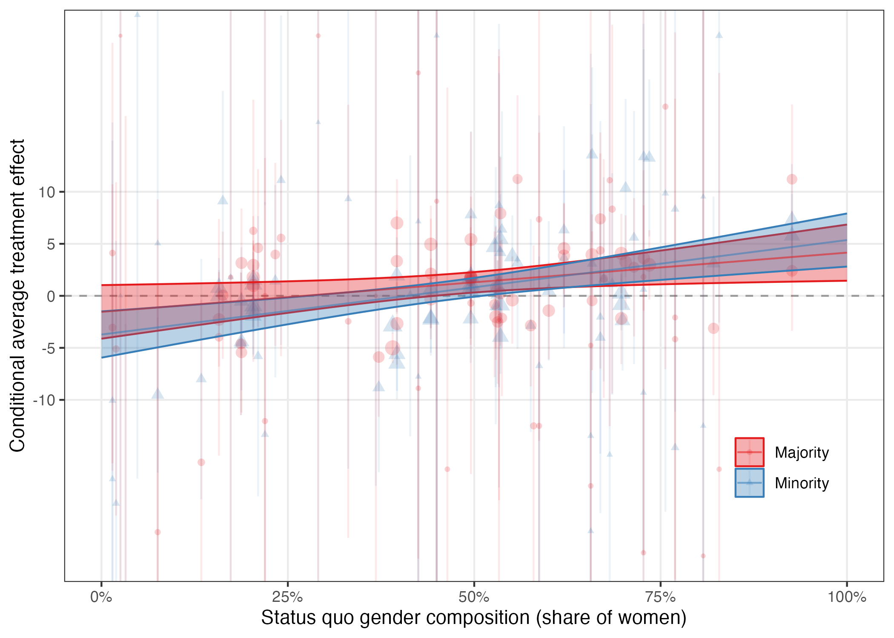
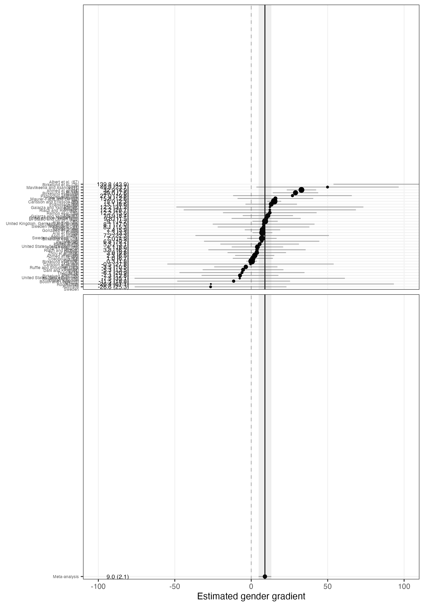

# Active Maintenance Report: galos_coppock_2023


- [Summary](#summary)
  - [Does the deposited archive run?](#does-the-deposited-archive-run)
  - [Does the maintained rewrite reproduce the
    paper?](#does-the-maintained-rewrite-reproduce-the-paper)
- [Paper overview](#paper-overview)
- [Original archive reproducibility](#original-archive-reproducibility)
  - [The loop that cannot write its own
    output](#the-loop-that-cannot-write-its-own-output)
  - [The bootstrap that ships at five
    iterations](#the-bootstrap-that-ships-at-five-iterations)
- [Errata](#errata)
- [Number-by-number comparison](#number-by-number-comparison)
- [The extraction and the two
  instruments](#the-extraction-and-the-two-instruments)
- [Tables 1 and 2](#tables-1-and-2)
- [Figures](#figures)
  - [Figure S1.1](#figure-s11)
  - [Figures S4.5 to S4.61](#figures-s45-to-s461)
  - [Figure S5.62](#figure-s562)
- [Maintained rewrite](#maintained-rewrite)
  - [Architecture](#architecture)
  - [Patterns replaced](#patterns-replaced)
- [R environment](#r-environment)

This repository holds the actively maintained replication code for Galos
and Coppock (2023), together with the reproducibility report that
documents what the original archive did and did not do. It is part of a
program applying the maintenance proposal in Peer, Orr and Coppock
(2021, *PS: Political Science & Politics*, doi
[10.1017/S1049096521000366](https://doi.org/10.1017/S1049096521000366))
to a set of published archives.

*Drafted by Claude Opus 5 under the supervision of Alex Coppock.*

|  |  |
|----|----|
| Article | [10.1126/sciadv.ade7979](https://doi.org/10.1126/sciadv.ade7979) |
| Replication archive | [10.7910/DVN/5MCRNY](https://doi.org/10.7910/DVN/5MCRNY) |

**The data are not redistributed here.** The deposit is 19 files at
Harvard Dataverse, which is the only copy this repository points at.
`download_original.R` fetches it and verifies every file against
`original_manifest.csv`, which pins the file identifiers, folder paths,
sizes and checksums, so the exact bytes this code was written against
are recorded in version control even though the bytes themselves are
not. The same script stops if `original/` holds anything the manifest
does not list, since a stray file makes a working copy differ from a
fresh clone in exactly the way a reproduction check exists to catch.

**Repository layout.** `maintained/` is the maintained rewrite: one
script per published table or figure, writing to `output/`, which is
committed so a reader can compare a fresh run against it without
downloading anything, plus `in_text_claims.R`, which recomputes every
claim the article makes and prints it beside the article’s own sentence.
`ground_truth/` ties every published number to the code that produces it
and holds the extraction of the published pages. `original/` is created
by the download script and is deliberately absent from the repository.
`errata.qmd` renders `galos_coppock_2023_errata.pdf`, the corrections to
the published article. This file is the reproducibility report, also
available as a PDF in `report/`.

**License.** CC0 1.0 Universal, matching the terms of the deposit this
repository maintains. See `LICENSE`.

**To reproduce.** Clone or download the repository, open
`galos_coppock_2023.Rproj`, and run:

``` r
source("run_all.R")
```

That fetches the deposit, verifies its 19 files, produces every table
and figure into `maintained/output/`, rebuilds the number-by-number
comparison table in `ground_truth/` and its gates, and prints the
recomputed value of every claim the article makes. Required packages:
tidyverse, metafor, broom, scales, rsample, modelsummary, knitr,
kableExtra, here. Paths resolve through `here`, so nothing depends on
the working directory. The full run takes about two and a half minutes,
almost all of it in the 500-resample bootstrap behind one standard error
in the Results section.

A successful run overwrites `maintained/output/`, which is committed:
**`git diff` on that folder is the reproduction check.** The CSV, TeX
and PNG files come back byte-identical. The eight figure PDFs always
differ, because a PDF records the time it was written, so a changed hash
there is not evidence of anything.

# Summary

Two questions, answered before the detail.

## Does the deposited archive run?

Almost. Eight of the ten deposited scripts run to completion on a
current R installation with no changes at all. One fails outright and
one runs but does not produce the published number.

`appendix_figures_and_loop.R` stops with an error on its first study. It
binds a study’s occupation-level estimates to a meta-regression row
obtained from `broom::tidy()`, which carries no `fraction_female`
column, and then sorts the combined frame with
`fct_reorder(occupation_label, fraction_female)`. The meta row’s
ordering value is `NA`, and `forcats::lvls_reorder()` refuses to order a
factor with a missing sort key. Because the error comes on the first
iteration, the loop never reaches its last line, which is the one that
writes `data/gender_gradients_df.rds`. That file is deposited and is
correct, and re-deriving it from the occupation CATEs agrees with it to
4e-13 on every estimate and standard error, so nothing downstream is
wrong. What is missing is any signal that the script and the object it
is meant to write have come apart.

`analyze_cates.R` runs, but ships with `sims <- 5` where the paper used
500, and a comment saying so. Five resamples give a bootstrapped
standard error of 0.54; five hundred give 0.578, which is the published
0.58. A reader who runs the archive as deposited gets a number that
disagrees with the paper in the second decimal place, with no error and
no warning.

Neither problem needs author intervention: the first is a two-line fix
and the second is a one-character one. Every package the archive names
still installs from CRAN.

Running the archive is not the same as reproducing the paper, and this
archive is a clear case of the difference. The scripts cover Tables 1
and 2, Figs. 4 and 5, and five of the supplementary figures, though
every one of them draws to the active graphics device and none calls
`ggsave()`, so the deposit as shipped writes no figure files at all.
They do not cover the 57 study-by-study panels of section S4, because
the loop that draws them fails and its `ggsave()` calls are commented
out in any case, and they do not cover the study manifest of table S2.1,
for which the deposit contains no code. That is 57 published figures and
one published table with no deposited source.

## Does the maintained rewrite reproduce the paper?

The ground truth records 533 values. 491 of the 519 that can be checked
against the article reproduce, including all 57 study-level average
treatment effects and their standard errors from fig. S1.1, all 12
survey experiment effects from fig. S3.4, all 37 study-level gender
gradients from fig. S5.62, every coefficient, standard error,
tau-squared and sample size in Tables 1 and 2, and all 335
estimate-and-standard-error labels printed on the 57 study panels.

The 28 that do not divide into two groups: 5 where the article disagrees
with itself, and 23 where the deposit does not carry the quantity the
published figure prints.

**The article against itself.** The paper reports that bias is larger in
women-dominated than in men-dominated occupations “by a statistically
significant 2.10 points”. The archive and the rewrite both give 2.10547,
which rounds to 2.11 at the printed precision; the published figure is
the truncation. Published Table 2 prints the Model 2 intercept as −3.72
with no significance stars, where the coefficient’s p-value is 0.00104
and the numerically identical −3.73 intercept in Model 3 does carry its
two stars; the estimate and its standard error are right and only the
marker is missing. Table S2.1 gives 18 occupations for Gonzalez et
al. and 24 for Dahl and Krog, where the corresponding study panels,
figs. S4.37 and S4.32, plot 17 and 21. The abstract says the experiments
were carried out across five continents, where the paper’s own evidence
map is drawn as six continent facets and its earliest study is
Australian.

**The deposit against the figures.** Every study panel labels each
occupation with three lines: its name, the share of women in it, and a
sample size. The first two reproduce for all 57 panels. The third is
only partly recoverable, because the deposit carries no subject counts.
What it does carry is the residual degrees of freedom of each
occupation’s own regression, and `df + 1` equals the published sample
size exactly for 167 of the 298 occupations, which is every occupation
of 35 of the 57 studies. For the other 22 the published figure is
several times larger, which is what a design with several applications
per job opening gives, and the deposit provides no way to recover the
multiplier. The same gap shows up in table S2.1, whose subject counts
reconstruct for the same 35 studies.

Not one of the 28 is a defect of the rewrite.

# Paper overview

**Citation**: Galos, D. R. and Coppock, A. (2023). “Gender composition
predicts gender bias: A meta-reanalysis of hiring discrimination audit
experiments.” *Science Advances*, 9, eade7979. DOI:
10.1126/sciadv.ade7979

**Summary**: Since 1983, more than 70 employment audit experiments have
randomized the gender of fictitious job applicants, and the results
point in both directions. This paper reconciles them with what the
authors call a meta-reanalysis. The microdata for 57 studies reported in
51 papers are obtained or reconstructed, each study is reanalyzed to
give conditional average treatment effects at the occupation level,
occupational gender composition is merged in from International Labour
Organization statistics, and the resulting 298 occupation-level
estimates are meta-regressed on the share of women in the occupation.
That slope is the gender gradient, and it is strongly positive: 8.15
percentage points per unit share female, with a standard error of 1.50.
In a fully men-dominated occupation the expected effect of being a woman
is −3.02 points; in a fully women-dominated one it is +5.13.
Discrimination, in other words, preserves the status quo gender
distribution rather than correcting it. The gradient survives country,
year, and study fixed effects, holds separately among majority and
minority status applicants, and reappears in a parallel meta-analysis of
12 vignette survey experiments.

# Original archive reproducibility

| Script | Status on current R | Resolution |
|:---|:---|:---|
| helpers.R | Clean (sourced by every analysis script) | No changes required |
| analyze_ates.R | Clean | No changes required |
| analyze_cates.R | Runs, but at 5 bootstrap resamples rather than the published 500 | Set sims to 500, as the script’s own comment instructs |
| analyze_cates_ethnicity.R | Clean | No changes required |
| analyze_cates_regression_tables.R | Runs; warns that redundant predictors were dropped from one model | No changes required; the warning is about collinear fixed effects |
| appendix_cates_survey_field.R | Clean | No changes required |
| appendix_evidence_map.R | Runs; warns that the size aesthetic for lines is deprecated | Use linewidth instead of size |
| appendix_figures_and_loop.R | Fails at fct_reorder on an NA ordering value | Replace the NA sort key before reordering |
| appendix_gender_gradient.R | Clean; reads the data file the failing loop script is meant to write | No changes required |
| appendix_survey_ates.R | Clean | No changes required |

Original archive reproducibility, checked against R 4.6.0.

Every package the archive’s README names still installs from CRAN:
`tidyverse`, `metafor`, `broom`, `scales`, `texreg` and `xtable`.
`texreg` is the one worth checking rather than assuming, because it is a
table-formatting package that writes only to the console; version 1.39.5
was released in December 2025 and is actively maintained. `xtable` is
loaded by `appendix_figures_and_loop.R` and never called.

The archive’s own checks are reproduced by
`ground_truth/archive_values.R`, which sources the deposited scripts
unmodified, harvests the objects they assign and the LaTeX tables they
print, and writes `ground_truth/archive_values.csv`. That file is the
source of the `value_script` column below. It is not part of
`run_all.R`, because “does the deposit reproduce the paper” and “does
the rewrite reproduce the paper” are different questions and answering
the first one should not be a precondition for running the second.

## The loop that cannot write its own output

`appendix_figures_and_loop.R` walks the 57 studies, fits a within-study
meta-regression wherever a study distinguishes three or more
occupations, and draws one appendix figure per study. Inside the loop it
builds a plotting frame:

``` r
local_dat <- local_dat |> bind_rows(local_meta)
local_dat <- local_dat |>
  ungroup() |>
  mutate(occupation_label = fct_reorder(occupation_label, fraction_female))
```

`local_meta` comes from `tidy()` applied to an `rma.uni` fit, and a
tidied model has no `fraction_female` column, so `bind_rows()` fills
that cell with `NA`. `fct_reorder()` then asks `lvls_reorder()` to order
a factor by a vector containing a missing value, which errors. Replacing
the missing key with `-Inf` before reordering fixes it and puts the meta
row first, which is where the published appendix figures show it.

The loop’s `ggsave()` calls are commented out in the deposit, so the
only thing it produces that anything else consumes is the last line,
`write_rds(gender_gradients_df, "data/gender_gradients_df.rds")`. That
file is deposited, and `appendix_gender_gradient.R` reads it to build
fig. S5.62. The archive is therefore internally consistent while being
unable to rebuild itself: the deposited object is right, and the code
that made it does not run.

That last line is also a hazard for anyone checking the archive, because
it writes into the archive directory and would replace a deposited file
with the output of the run. Deposited code is run in a scratch copy
under `tempdir()` here for that reason, and `original/` is verified
against the manifest on every run.

## The bootstrap that ships at five iterations

`analyze_cates.R` estimates the difference in the magnitude of bias
between fully women-dominated and fully men-dominated occupations, and
bootstraps its standard error:

``` r
set.seed(343)
# sims <- 500
sims <- 5
```

The published standard error is 0.58. At five resamples the archive
prints 0.54.

# Errata

Twelve things in the published article do not survive the comparison:
seven statements and figures checked against the deposit, and five
reference-list entries checked against Crossref or against the list’s
second printing in the supplementary materials. They are collected in
`galos_coppock_2023_errata.pdf` at the root of this repository, which
renders from `errata.qmd` and computes every corrected number from
`maintained/output/` at the time it is rendered. The note also carries
five passages this edition reprints unchanged, each quoted with the
reason it is not corrected. **None of them changes a conclusion of the
paper.**

| Correction | Evidence |
|:---|:---|
| The record spans six continents, not five | The paper’s own evidence map, fig. S2.2, is drawn as six continent facets: Africa, Asia, Europe, N. America, Oceania, S. America. Section S2 names Oceania among the regions where the boom in audit experimentation occurred, and the earliest study in the whole record, the Australian one the introduction discusses, is on that continent. The sentence describes the wider literature rather than the 57 studies reanalysed here, but a superset of those studies cannot span fewer continents, so five is too few under any reading. |
| Table S2.1 overstates the occupation counts for two studies | The article disagrees with itself in these two rows. Figs. S4.37 and S4.32 plot 17 and 21 occupations for the same two studies, and 17 and 21 is what the deposited data hold. The other 55 rows of the column are right. The table is not reprinted here because its N subjects column cannot be regenerated from the deposit, which carries no subject counts. |
| Table 2’s Model 2 intercept carries no significance marker | The Model 2 intercept is printed as −3.72 with no marker, at a p-value of 0.00104. Five decimals rather than the three the table’s own note uses: at three the p-value reads 0.001, which is the threshold for the third star rather than the second, and the correction would be ambiguous inside the rule it is being compared against. The numerically identical Model 3 intercept, −3.73, does carry its two stars. The estimate and its standard error are right and only the marker is missing, so what is corrected here is the table rather than any sentence. |
| The article cites a supplementary figure that does not exist | The supplementary materials list Figs. S1.1 to S6.63 in their front matter, and the PRISMA flow diagram is the last of them. There is no fig. S6.66. The same paragraph cites the evidence map as fig. S.2.2, where the figure itself is numbered S2.2. |
| The difference in the magnitude of the two predicted biases | The deposited code and the maintained rewrite both give 2.10547, which rounds to 2.11 at the two decimal places the sentence prints. The published figure is the truncation rather than a different number, and the bootstrapped standard error, 0.5781, is 0.58 as published. |
| Reference 22 demotes half of an author’s surname to an initial | The third author’s surname is the compound Baier Manwell, and the entry reads its first element as a middle initial. Crossref, doi 10.1097/acm.0000000000000552: Carnes, Molly; Devine, Patricia G.; Baier Manwell, Linda; Byars-Winston, Angela. PubMed indexes her the same way, as Baier Manwell L. |
| Reference 65 breaks two surnames beginning “Mc” | Joanne E. McKenzie’s surname is set with a space, and Steve McDonald’s is split so that its “Mc” reads as a middle initial. Crossref, doi 10.1136/bmj.n71: McKenzie, Joanne E is the second author and McDonald, Steve the nineteenth. The defect is specific to these two names rather than general to the typesetting: the same entry sets L. A. McGuinness correctly three names later, and reference 60 sets M. McPherson correctly. |
| Figure 4 colors imputed gender composition categories as though the study authors had given them | Of the 298 study-occupation cells the figure draws, only 174 carry a gender composition category the original study’s own authors assigned; the remaining 124 were filled in by us from where the occupation falls in the ILO gender distribution. The caption discloses that in words, so the article is accurate about what it did, but the figure gives all 298 points the same three colors, and a color is a claim about the occupation that a reader cannot tell apart from the 174 that were coded. The corrected figure draws the 124 imputed cells in grey, keeping their position, their interval and their weight. NO ESTIMATE MOVES: the meta-regression is fitted on the continuous share of women in the occupation and never on the category, so Tables 1 and 2, the gender gradient and every study-level effect in the supplementary materials are exactly as published. What changes is which of 298 points is which color. The coding is the same authors’ own, carried back from the successor project, where the distinction is kept as a column and the imputed categories are dropped rather than plotted. |
| Figure S1.1 prints a clipped estimate for Neumark et al. | The figure’s own text carries the right number and the page does not print it. Read off the glyphs, the row holds exactly 2 . 3 space ( 8 . 4 ) beginning at x0 = 268.50, which is where every other three-character value in the column begins, and no minus and no 1 is inked anywhere to its left: the short dash that sits there is the row’s axis tick, which the positive rows carry too. The authors’ own field_ates_plot.pdf is the same in both respects, so the leading −1 was lost when the figure was drawn rather than when it was composed: the label overflows the plot panel and its −1 is clipped out of the ink, while the text layer keeps it, which is why pdftotext reports −12.3 for a page that shows 2.3 and why a token gate cannot see this defect at all. Nothing about the estimate is in doubt. The article’s own introduction prints it as (−12.3 points, SE: 8.4 points) and the deposit gives −12.307692 (8.384118), so the paper disagrees with itself the way entry 2 records for table S2.1. The corrected figure is the maintained pipeline’s own, which draws the full value: of the 420 words and numbers it carries, 419 are on the published page and the one exception is the restored −12.3. |
| Reference 9 separates two coauthors with a semicolon | The entry names three coauthors and separates the first two with a semicolon and the second two with a comma, so it is inconsistent with itself before it is compared with anything. Crossref, doi 10.2307/2946676: David Neumark, Roy J. Bank and Kyle D. Van Nort are three authors of one article, Q. J. Econ. 111, 915-941 (1996). Every one of the other 127 entries in this list separates its authors with commas, and the supplementary materials set this same reference with a comma. The defect is specific to the article’s printing of it. |
| Reference 71 in the supplementary materials drops the period after its number | Every other entry in both printings of this list numbers itself with a digit and a period, and the article’s own printing of this same reference has one. Read off the line boxes of supplementary p. 53, reference 71 begins at the item edge x0 = 0.088 like its neighbours and its number is followed by a space rather than a period. It is the only one of the 128 that is, which is what makes it a slip rather than a convention. |
| Reference 83’s page range ends one page early, in both printings of the list | Crossref, doi 10.1086/511799: Shelley J. Correll, Stephen Benard and In Paik, “Getting a Job: Is There a Motherhood Penalty?”, American Journal of Sociology 112, 1297-1339 (2007). The supplementary materials reprint the entry with the same range, so it is corrected in both places. |

The twelve corrections, in the order the errata note gives them. Both
columns are read from the errata spine.

Three of the twelve are contradictions between two parts of the article:
the abstract against the paper’s own evidence map, table S2.1 against
the study panels, and the PRISMA cross-reference against the
supplement’s own figure numbering. Two more are a dropped typesetting
marker and a truncation, both of which the deposited code itself gets
right. Two are figures: Figure 4 colors imputed categories as though
they had been coded, and Figure S1.1 prints an estimate clipped short of
its own value. The rest are reference-list entries, which the deposit
cannot speak to at all: one author’s compound surname reduced to an
initial, two surnames beginning “Mc” broken in a single entry, two
defects found by diffing the article’s printing of the list against the
supplement’s, and a page range that ends a page early in both.

This is separate from the question of whether the maintained rewrite
corrected anything in the deposited code. It did not: the rewrite makes
no analytical change and fixes no bug, and the two changes it does make
to how the archive runs, raising the bootstrap from five resamples to
the published five hundred and replacing an `NA` sort key, are described
above.

# Number-by-number comparison

The ground truth is at
`ground_truth/galos_coppock_2023_ground_truth.csv` and is generated by
`ground_truth/build_ground_truth.R`, which runs as the last step of
`run_all.R`. Its only typed numbers are the `value_paper` column, read
from the published article and its supplementary materials;
`value_script` is read from the harvest of the deposited code and
`value_rewrite` out of `maintained/output/`. The verdicts are computed
at the precision the article prints rather than asserted.

It records 533 values. 299 of them have both a published counterpart and
a deposited-code counterpart, and of those 293 match and 6 do not.

Most of the published values are inside figures rather than in prose.
Figures S1.1, S3.4 and S5.62 print the estimate and standard error
beside every point, which makes 218 published numbers that no sentence
in the paper states. The 57 study panels of section S4 print another
335. All of them are extracted from the supplementary PDF and checked
one by one.

| Location | Published values checked | Rewrite matches | Rewrite mismatches |
|:---|---:|---:|---:|
| figs_S4.5_to_S4.61 | 173 | 151 | 22 |
| fig_S1.1 | 116 | 115 | 1 |
| fig_S5.62 | 76 | 76 | 0 |
| text | 40 | 35 | 2 |
| fig_S3.4 | 26 | 26 | 0 |
| table_2_model3 | 14 | 14 | 0 |
| table_1_model1 | 8 | 8 | 0 |
| table_1_model2 | 8 | 8 | 0 |
| table_1_model3 | 8 | 8 | 0 |
| table_1_model4 | 8 | 8 | 0 |
| table_1_model5 | 8 | 8 | 0 |
| table_2_model1 | 8 | 8 | 0 |
| table_2_model2 | 8 | 7 | 1 |
| text_S5 | 8 | 8 | 0 |
| table_S2.1 | 4 | 2 | 2 |
| text_S1 | 3 | 3 | 0 |
| text_S2 | 3 | 3 | 0 |
| text_S4 | 2 | 2 | 0 |
| text_S3 | 1 | 1 | 0 |

Where the checkable published numbers are, and how the rewrite does
against them.

| Location | Quantity | Paper | Rewrite | Where the fault lies |
|:---|:---|:---|---:|:---|
| text | Continents the experiments were carried out across | 5 | 6.000 | paper_internal |
| text | Difference in magnitude, 100 vs 0 percent women (pp) | 2.10 | 2.105 | paper_internal |
| table_2_model2 | Intercept significance stars (0 = none, 1 = one, 2 = two, 3 = three) | 0 | 2.000 | paper_internal |
| table_S2.1 | Subject counts reproduced | 57 | 35.000 | archive |
| table_S2.1 | Occupation counts reproduced | 57 | 55.000 | paper_internal |
| fig_S1.1 | ATE: Neumark et al. (9): United States | 2.3 | -12.308 | paper_internal |
| fig_S4.8 | Occupation sample size labels, Alden et al. (68): Sweden | 2 | 0.000 | archive |
| fig_S4.11 | Occupation sample size labels, Asali et al. (70): Georgia | 9 | 0.000 | archive |
| fig_S4.13 | Occupation sample size labels, Baert et al. (71): Belgium | 1 | 0.000 | archive |
| fig_S4.14 | Occupation sample size labels, Baert et al. (72): Belgium | 1 | 0.000 | archive |
| fig_S4.17 | Occupation sample size labels, Berson (75): France | 1 | 0.000 | archive |
| fig_S4.28 | Occupation sample size labels, Carlsson (13): Sweden | 13 | 0.000 | archive |
| fig_S4.32 | Occupation sample size labels, Dahl and Krog (84): Denmark | 21 | 3.000 | archive |
| fig_S4.33 | Occupation sample size labels, Edo et al. (85): France | 3 | 0.000 | archive |
| fig_S4.37 | Occupation sample size labels, Gonzalez et al. (89): Spain | 17 | 0.000 | archive |
| fig_S4.38 | Occupation sample size labels, Hipp (90): Germany | 1 | 0.000 | archive |
| fig_S4.42 | Occupation sample size labels, Neumark et al. (9): United States | 1 | 0.000 | archive |
| fig_S4.43 | Occupation sample size labels, Nunley et al. (93): United States | 6 | 0.000 | archive |
| fig_S4.44 | Occupation sample size labels, Oreopoulos (94): Canada | 21 | 1.000 | archive |
| fig_S4.46 | Occupation sample size labels, Pedulla (96): United States, field experiment | 4 | 0.000 | archive |
| fig_S4.47 | Occupation sample size labels, Petit (97): France | 1 | 0.000 | archive |
| fig_S4.50 | Occupation sample size labels, Riach and Rich (8): Australia | 7 | 0.000 | archive |
| fig_S4.51 | Occupation sample size labels, Riach and Rich (100): England | 4 | 0.000 | archive |
| fig_S4.52 | Occupation sample size labels, Rivera and Tilcsik (101): United States, field experiment | 1 | 0.000 | archive |
| fig_S4.53 | Occupation sample size labels, Rooth (102): Sweden | 7 | 0.000 | archive |
| fig_S4.54 | Occupation sample size labels, Ruffle and Shtudiner (103): Israel | 10 | 1.000 | archive |
| fig_S4.60 | Occupation sample size labels, Zhou et al. (108): China | 4 | 0.000 | archive |
| fig_S4.61 | Occupation sample size labels, Capéau et al. (82): Belgium | 1 | 0.000 | archive |

Every published value the rewrite does not match, and where the fault
lies.

The 11 remaining recorded quantities are ones the scripts produce and
the paper never prints: the mean and median number of occupations per
study, the count of survey occupation CATEs, the intercept and slope of
the two fitted lines in fig. S3.3, which are drawn but never stated
numerically, and the four distances that stand behind a sentence
describing two quantities as similar or stable. They are recorded with
no published counterpart rather than counted as matches.

A further 3 claims are recorded with a published value and no verdict,
because the article states them as approximations. “Two-thirds (37 of
57)” and “over the past four decades” are true at the precision they
claim and false at any finer one, so both numbers are recorded and
neither is scored.

**Coverage is recorded as a fraction, not as a yes or no.** A float with
one row against a hundred published cells satisfies any check that asks
only whether the float appears, so the build counts the numbers each
published float prints on its face and requires the ground truth to
account for all of them. `ground_truth/float_coverage.csv` holds that
count float by float. Of the 71 floats the article and its supplementary
front matter list, 64 carry rows here. The 63 that print numbers on
their faces carry 1,389 published values between them, and the ground
truth reaches every one, so each of those floats is covered in full. The
build stops if any float falls below that.

The remaining 7 published floats have no row here, and the build stops
if a float has neither a row nor a stated reason, since a false reason
tells the next reader not to look. Figures 1 and 2 are diagrams of the
two gender gradients the theory admits and plot no estimates. Figure 3
summarises the discrimination mechanisms the 51 papers discuss, coded by
hand; the deposit carries no mechanism or discipline variable, so
nothing in the pipeline can reach it. Figures 4 and 5 print no numbers
on their faces, and the estimates and lines they draw are the 298
occupation CATEs and the Table 1 and Table 2 fits, all covered above.
Figure S2.2 is a map of country-by-year tiles, and what it asserts is
checked through the section S2 sentences that describe it. Figure S6.63
is a PRISMA flow diagram whose counts come from the screening process
and not from any data file in the deposit.

# The extraction and the two instruments

The comparison above answers “does the pipeline reproduce the published
floats.” It cannot answer “does the pipeline reproduce the published
article,” because a ground truth built float by float has no way to
notice a sentence. Two further files close that gap.

**The extraction.** `ground_truth/published_claims.csv` is a
hand-reviewed list of every numeric claim the article and its
supplementary materials make: 596 of them, each with the string the page
prints and a classification.

| Claim type   | No block | Needs a block |
|:-------------|---------:|--------------:|
| definitional |        6 |            12 |
| descriptive  |        0 |            18 |
| pipeline     |        0 |           500 |
| structural   |       23 |            27 |
| transcribed  |        8 |             2 |

The extraction, by claim type. A pipeline or descriptive claim must have
both a block and a ground truth row; the other three types get a block
only where the pipeline can reach the quantity, and are otherwise
verified at the point of use.

The float cells are read off the supplementary PDF’s own text layer by
`ground_truth/extract_published_claims.R`, which is not part of
`run_all.R` because this repository does not carry the published PDFs.
The prose claims, the two published tables and the front matter are
typed from the page. That makes the extraction a second transcription of
the same pages the ground truth transcribes, and the build compares the
two: all 522 published values they share agree, digit for digit.

**The second instrument.** `maintained/in_text_claims.R` recomputes
every claim the extraction says needs a block, from
`maintained/output/`, by its own path. It carries the article’s own
sentence verbatim in a comment above each block and prints one line per
claim. It never reads the ground truth. `build_ground_truth.R` runs it,
counts what it printed against what the extraction declares, and stops
if the two disagree; it then compares the two instruments value by
value, and stops if they land on different numbers. The 175 claims about
summarised floats are exempt from that last comparison, because their
ground-truth value is a count of agreements with the published page and
an instrument that never reads the page cannot recompute one.

**Three findings came from the extraction and not from the floats.** The
abstract’s “five continents” against an evidence map drawn as six is the
first, and it is now the first entry of the errata. The second is the
article’s own cross-reference to fig. S6.66. The third is a disagreement
the article has with itself about a date: the introduction says the
earliest study sent its applications in 1986, while the abstract dates
the record from 1983 and the deposit’s own study table and evidence map
both put that study in 1983. Which is right is a fact about the cited
1987 paper rather than about this deposit, so it is recorded and left
there rather than corrected.

A fourth is worth stating and is not an erratum either. The Design
section says the PRISMA search “yielded over 70 papers that met our
inclusion criteria”, where the PRISMA flow diagram of fig. S6.63 reports
51 reports included and 89 assessed for eligibility. No reading of the
diagram gives over 70, and nothing in the deposit records the search, so
the sentence cannot be corrected from the pipeline.

# Tables 1 and 2

Both published tables reproduce in full, coefficients, standard errors,
significance markers, tau-squared and sample sizes alike, with the
single exception of the Model 2 intercept marker in Table 2.

| Model   | Intercept    | Gender gradient | Tau squared | Nobs |
|:--------|:-------------|:----------------|------------:|-----:|
| Model 1 | -3.02 (0.81) | 8.15 (1.50)     |       12.57 |  298 |
| Model 2 | -2.48 (1.58) | 8.33 (1.58)     |       11.71 |  298 |
| Model 3 | -5.43 (1.91) | 8.69 (1.56)     |       12.56 |  298 |
| Model 4 | -5.20 (1.82) | 7.97 (1.57)     |       10.22 |  298 |
| Model 5 | 1.05 (1.96)  | 7.51 (1.54)     |        8.89 |  298 |

Table 1 as reproduced by the maintained rewrite. Standard errors in
parentheses.

| term                | Model 1      | Model 2      | Model 3      |
|:--------------------|:-------------|:-------------|:-------------|
| Intercept           | -1.55 (1.31) | -3.72 (1.13) | -3.73 (1.14) |
| Gender gradient     | 5.70 (2.50)  | 9.08 (2.26)  | 9.11 (2.28)  |
| Majority status     | NA           | NA           | 2.19 (1.74)  |
| Majority x gradient | NA           | NA           | -3.42 (3.37) |

Table 2 as reproduced by the maintained rewrite. Model 1 is the majority
status group, model 2 the minority status group, model 3 both. Standard
errors in parentheses.

# Figures

The main text carries two figures of results and the supplementary
materials sixty-one more, of which the rewrite reproduces all sixty-one:
the two forest plots, the evidence map, the survey-against-field
comparison, the gender gradient forest plot, and the 57 study-by-study
panels.





## Figure S1.1

Fig. S1.1 is a forest plot of all 57 field studies, each labelled with
its estimate and standard error. All 116 of those labels reproduce,
along with the meta-analytic summary of 1.2 points with a standard error
of 0.4.

| Study                                                     | ATE (SE)    |
|:----------------------------------------------------------|:------------|
| Albert et al. (67): Spain                                 | 9.9 (1.8)   |
| Birkelund et al. (76): the Netherlands                    | 8.3 (3.2)   |
| Becker et al. (74): Austria, Germany, Switzerland         | 8.1 (0.9)   |
| Rivera and Tilcsik (101): United States, field experiment | -3.8 (3.3)  |
| Arai et al. (69): Sweden (equivalent CVs)                 | -6.3 (4.0)  |
| Neumark et al. (9): United States                         | -12.3 (8.4) |

The three largest and three smallest of the 57 study-level effects in
fig. S1.1, all of which reproduce.

## Figures S4.5 to S4.61

The 57 study panels are the densest published numbers in the paper and
the part of it the deposit does not draw. `figure_s4_study_panels.R`
rebuilds them as one paginated PDF, one page per study, and writes every
plotted value to CSV. All 335 estimate-and-standard-error labels and all
298 gender composition labels reproduce. The sample size labels are the
exception described above: `df + 1` recovers 167 of the 298. That is
every occupation of 35 studies, plus five scattered across the other 22.

## Figure S5.62

The 37 study-level gender gradients are the paper’s own evidence that a
single audit experiment cannot see the pattern it documents: only 7 of
the 37 are individually significant, which the paper glosses as putting
the power of the average study at roughly 19 percent. All 37 estimates,
their standard errors, and the meta-analytic 9.0 with a standard error
of 2.1 reproduce.



# Maintained rewrite

The rewrite lives in `maintained/`: `helpers.R` plus fifteen scripts
covering one cleaning step, three published tables, eight figures, two
sets of in-text quantities, and the claims file that recomputes every
number the article states. It is a translation, not a reanalysis. Every
estimator, specification and sample restriction is the one the paper
used, and the published tables come out of `metafor::rma.uni()` with the
same formulas the archive writes.

## Architecture

| Script | Produces |
|:---|:---|
| helpers.R | Packages, paths, formatting helpers |
| clean_gender_gradients.R | gender_gradients.csv |
| table_1_meta_regression.R | table_1_meta_regression.tex and .csv |
| table_2_ethnicity_meta_regression.R | table_2_ethnicity_meta_regression.tex and .csv |
| table_s2_1_study_manifest.R | table_s2_1_study_manifest.tex and .csv |
| figure_4_cates_gender_gradient.R | Figure 4 |
| figure_5_cates_ethnicity.R | Figure 5 |
| figure_s1_1_field_ates_forest.R | Figure S1.1 and its 116 plotted values |
| figure_s2_2_evidence_map.R | Figure S2.2 |
| figure_s3_3_survey_field_comparison.R | Figure S3.3 and the two fitted gradients |
| figure_s3_4_survey_ates_forest.R | Figure S3.4 and its 26 plotted values |
| figure_s4_study_panels.R | Figures S4.5 to S4.61 and their 335 plotted values |
| figure_s5_62_gender_gradient_forest.R | Figure S5.62 and its 76 plotted values |
| text_summary_stats.R | The counts quoted in the text and in section S5 |
| text_difference_in_magnitude.R | The predicted CATEs and the bootstrapped SE |
| in_text_claims.R | One printed line per claim the article makes |

The maintained rewrite.

Four decisions are worth stating.

**The study-level gender gradients are recomputed, not read.**
`clean_gender_gradients.R` refits the 37 within-study meta-regressions
from the occupation CATEs rather than loading the deposited
`gender_gradients_df.rds`. Depending on that file would mean depending
on an intermediate the deposited code cannot regenerate. The two agree
to 4e-13.

**The uncovered floats are covered.** `figure_s4_study_panels.R` and
`table_s2_1_study_manifest.R` rebuild the 57 study panels and the study
manifest, neither of which the deposit produces. Rebuilding them is what
makes the gaps in the deposit measurable: without a reconstruction there
is nothing for the 335 panel labels and the 171 manifest cells to be
compared against.

**Every value that appears in `output/` is computed from the deposited
data.** No published number is typed into a script as an input to a
calculation, and the figures write their plotted labels to CSV so that a
value shown in a figure can be traced to the fit that produced it rather
than to a transcription.

**The bootstrap runs at 500 resamples.** That is the cost of the
published standard error and it is paid rather than avoided.
`rsample::bootstraps()` at `set.seed(343)` gives the same resamples as
the archive’s `sample_n()` loop, so the two agree exactly at 0.5781.

## Patterns replaced

| Original pattern | Replacement | Reason |
|:---|:---|:---|
| magrittr pipe | native pipe | House style |
| `rm(list = ls())` | (omitted) | House style |
| relative paths from the archive root | `here::here()` | Scripts must run from the project root |
| `texreg()` printed to the console | `modelsummary(output = ...)` to `.tex`, plus `write_csv()` | Console-only output cannot be diffed between runs |
| `size =` in `geom_hline()` | `linewidth =` | Deprecated in ggplot2 3.4.0; warns on every run |
| `fct_reorder()` on an NA sort key | replace the key with `-Inf` before reordering | Errors in forcats 1.0.0 |
| `legend.position = c(x, y)` | `legend.position = "inside"` with `legend.position.inside` | House style; the numeric form still works |
| `sims <- 5` with a comment to raise it | `sims <- 500` | Recovers the published standard error |
| manual `sample_n()` bootstrap loop | `rsample::bootstraps()` | Same resamples at the same seed, in a maintained package |
| `predict.rma()` called directly | `predict()` with S3 dispatch | Method called by name rather than through the generic |

Patterns replaced in the maintained rewrite.

`xtable` is loaded by the archive but never called, so it is simply
dropped. `texreg` still installs and still works; it is replaced because
it writes only to the console, which means the published tables exist
nowhere as files and cannot be diffed between runs.

# R environment

| Item      | Value                  |
|:----------|:-----------------------|
| R version | 4.6.1                  |
| Platform  | aarch64-apple-darwin23 |

| Package      | Version |
|:-------------|:--------|
| tidyverse    | 2.0.0   |
| metafor      | 5.0.1   |
| broom        | 1.0.13  |
| scales       | 1.4.0   |
| rsample      | 1.3.2   |
| modelsummary | 2.6.0   |
| knitr        | 1.51    |
| kableExtra   | 1.4.0   |
| here         | 1.0.2   |

Package versions used for the run behind this report.
